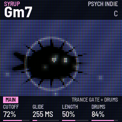

# Blop

*by Obsimo*

Blop is a firmware for the M-VAVE FM-1 by Obsimo (OSR Records): one-finger chord grids, chord rhythms, a bass with its
own riffs, a few discreet drums with sidechain, and a little creature that swims in an aquarium on the screen,
following your chords.

Version {{VERSION}}. Not yet tested on many FM-1s: installing is at your own risk; the installer can put M-VAVE's own
firmware back.

- [Try it in the browser](emu/): the same code the FM-1 runs, with sound. No FM-1 needed.
- [Install](install/): from Chrome or Edge, with the FM-1 connected by USB.
- [Download {{PKG}}](firmware/{{PKG}}): for the command-line installer, `python3 tools/fm1_install.py {{PKG}}`.
- [Source](https://github.com/OSR-Experiment/OSR-1): GPL-3.0. Built on fm1-base (Charles Vestal) and felucca-bsp
  (Leo Kuroshita, Hügelton Instruments).

The keys play the chords of the grid, the top row of buttons chooses what the four small knobs do (shown at the
bottom of the screen), the bottom row is for fun. Hold HOME for the help screen. The chords and the bass go out as
MIDI over USB, channel 1.

Go stream Obsimo's music ;)

M-VAVE and FM-1 are trademarks of their owners. Blop is not affiliated with M-VAVE.
